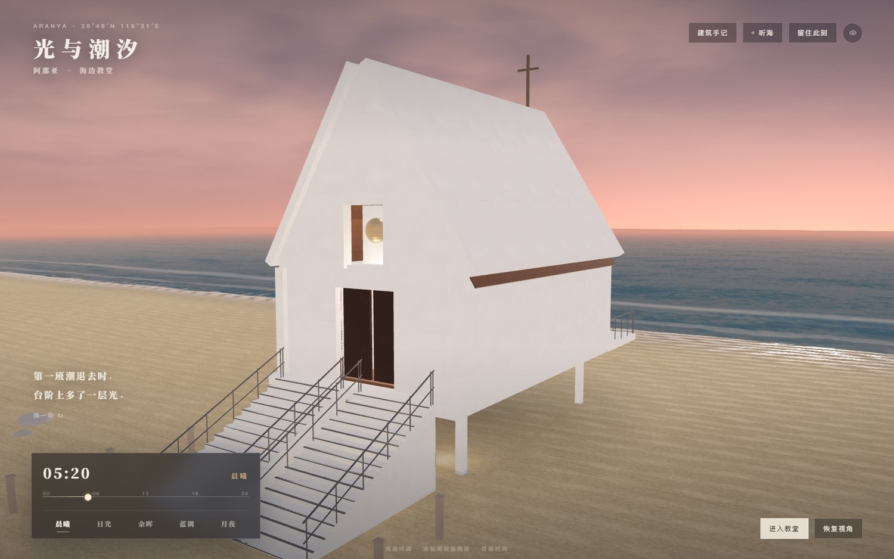
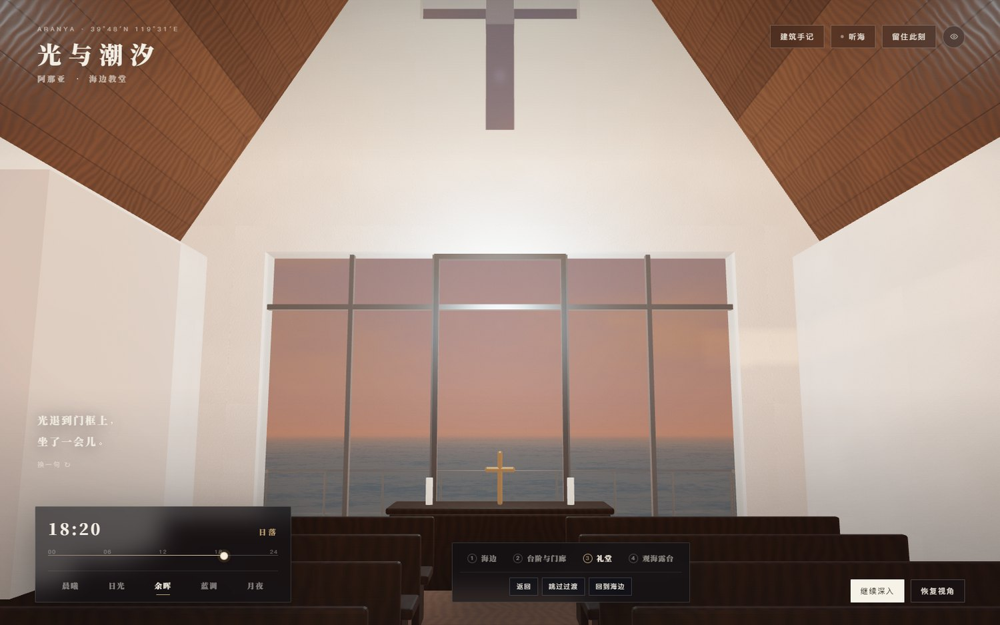

# 光与潮汐 · 阿那亚海边教堂

一座可以拨动时间的 3D 海边教堂体验：全屏实时渲染，连续时间滑杆，五个时刻（晨曦 / 日光 / 余晖 / 蓝调 / 月夜），动态海岸，可进入的礼堂与观海露台，合成潮声、原创短诗与本地生成的黑白留白纪念卡。

> 非官方作品，致敬直向建筑与阿那亚。建筑比例、开口与家具为实时体验重新编排，并非测绘级复原。`n`n`n

## 在线体验

**https://macabyavaha7-sys.github.io/aranya-light-tide/**

无需登录。桌面与手机均可打开。

## 功能

- **时间**：0–24 时连续滑杆 + 五个快捷时刻；天空、太阳/月亮位置、光向、阴影、环境反射、海色、雾与室内暖灯连续过渡。切换时间不会重置相机，建筑位置、比例、朝向固定。
- **相机**：拖动环顾、滚轮 / 双指缩放、恢复视角、隐藏界面（`H`，或轻点画面恢复）。环顾以建筑正面为中心限制在 ±76°，避免穿入建筑或看到未完成的背面——这是策展选择，不是故障。桌面快捷键 `1`–`5` 切换时刻，`Space` 跳过镜头过渡，`Esc` 关闭面板。
- **海岸**：程序化 Gerstner 波、细碎反光、向岸推进的泡沫与干湿沙过渡；海浪动画独立运行，不随光影时间跳变。
- **室内路线**：海边 → 台阶与门廊 → 礼堂 → 观海露台，一条连续样条路径绕开影壁与家具，视线沿路径前探并阻尼跟随，室内保持 1.62 m 人眼高度；木门接近时开启，海侧玻璃中扇是口袋推拉门，走向露台时自动滑开；可转头、返回、跳过过渡。
- **听海**：合成潮声，默认关闭；进入礼堂后变轻、变闷，切换标签页时淡出。
- **短诗**：随时间段变化，可「换一句」。
- **留住此刻**：截取当前真实三维画面，保留时间、地点、视角与完整构图，可填写收件人与寄语，生成纸色留白 PNG 纪念卡。全部在浏览器本地合成，不上传、不公开。
- **建筑手记与资料来源**：见页面内「建筑手记」。

## 本地运行

要求 Node.js 20+。

```bash
npm install
npm run dev        # http://127.0.0.1:5173
npm run build      # 类型检查 + 生产构建，输出 dist/
npm run preview    # 预览 dist，http://127.0.0.1:4173
```

`dist/` 可直接放到任意静态托管（GitHub Pages、Vercel、Netlify、Nginx）。Vite 使用 `base: './'`，放在子路径下也能正常加载模型。

## 重建三维模型

Blender 源文件：`blender/aranya-chapel.blend`；导出模型：`public/models/chapel.glb`。

```bash
# Blender 4.5（Windows 便携版亦可）
blender -b -P blender/build_chapel.py
```

脚本会程序化生成平台、双跑台阶（中间 600 mm 缝隙）、白色抹灰墙体、尖顶屋面与屋脊天光缝、钟龛与十字、木门、长椅、祭坛、观海露台与细栏杆；生成抹灰 / 木纹贴图并打包进 GLB。渲染校验图：

```bash
blender -b blender/aranya-chapel.blend -P blender/render_preview.py
```

生成物：`blender/aranya-chapel.blend`、`public/models/chapel.glb`、`blender/textures/*.png`、`blender/preview/*.png`。

## 目录

```
aranya-light-tide/
├─ index.html            页面结构与文案
├─ src/
│  ├─ main.ts            应用装配、时间、UI、纪念卡、快捷键
│  ├─ world.ts           天空、海面、沙滩、光照、材质、时间系统
│  ├─ camera.ts          环视与室内镜头路线
│  ├─ audio.ts           合成潮声
│  ├─ poems.ts           原创短诗
│  ├─ postcard.ts        纪念卡绘制
│  └─ styles.css         克制的宋体界面
├─ public/models/chapel.glb
├─ blender/              Blender 源文件、建模与预览脚本、贴图
├─ dist/                 已构建的静态站点（可直接部署）
└─ screenshots/          场景截图
```

## 实现说明

- **天空**：自定义着色器渐变、太阳/月亮、云、星空与近地平线暖带；同一套调色板驱动海面反射，保证地景与天空衔接。
- **海面**：顶点位移 + 解析法线 + 细节噪声，菲涅尔反射天空，太阳高光与碎金，岸线泡沫只出现在近岸，远处溶入地平线色。
- **沙滩**：程序化沙纹贴图与法线，顶点 dunes；注入式的湿润带与风向噪声，随潮汐时间轻微摆动。浮木、礁石与系缆桩在 Blender 中建模，随 GLB 一同导出。
- **材质**：Blender 烘焙/生成 512² 抹灰与木纹（albedo / roughness / normal），随 GLB 打包；墙面叠加世界坐标的风化与基部压暗；主要构件带 18 mm 倒角以接住斜光。玻璃为轻量透明材质，保证移动端帧率。
- **性能**：像素比上限（移动端 1.75 / 桌面 2）、阴影贴图 1024/2048、海面网格按设备降级、草丛实例化、环境贴图节流更新。桌面约 93 draw calls / 12.8 万三角形。
- **无障碍 / 降级**：`prefers-reduced-motion` 降低动效；加载失败有明确提示；WebGL 不可用时页面提示而非白屏。

## 资料来源

- 谷德设计网：海边教堂，秦皇岛 / 直向建筑 — https://www.gooood.cn/seashore-chapel-china-by-vector-architects.htm
- Vector Architects：Chapel of Music, Aranya — https://www.vectorarchitects.com/en/projects/65
- 直向建筑官网 — https://www.vectorarchitects.com/
- 参考照片 © 陈颢、施峥、CreatAR Images / 直向建筑，仅用于研究与非商业的氛围参考，未随站点分发。

## 版权

代码与三维模型：本作品原创，供学习与个人使用。建筑概念、名称与实景照片版权归直向建筑（Vector Architects）及相关摄影师所有；如涉权利问题请联系删除。
